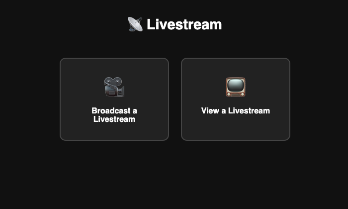
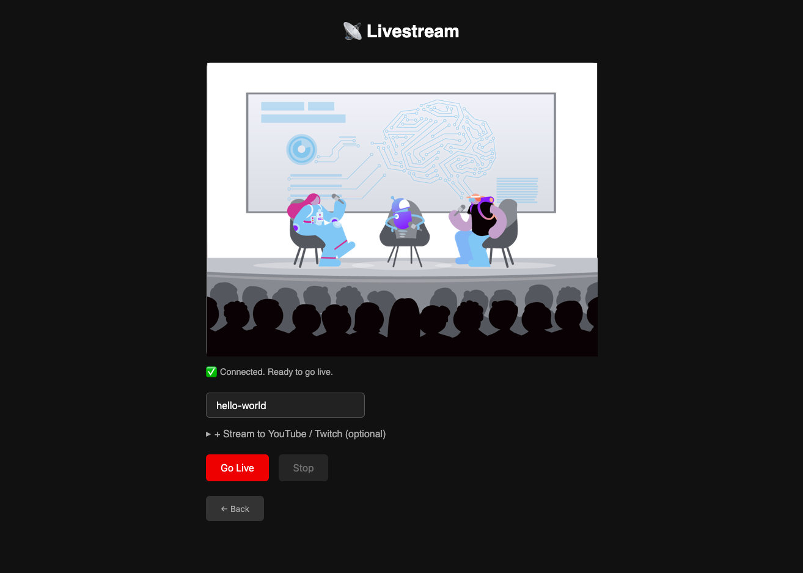
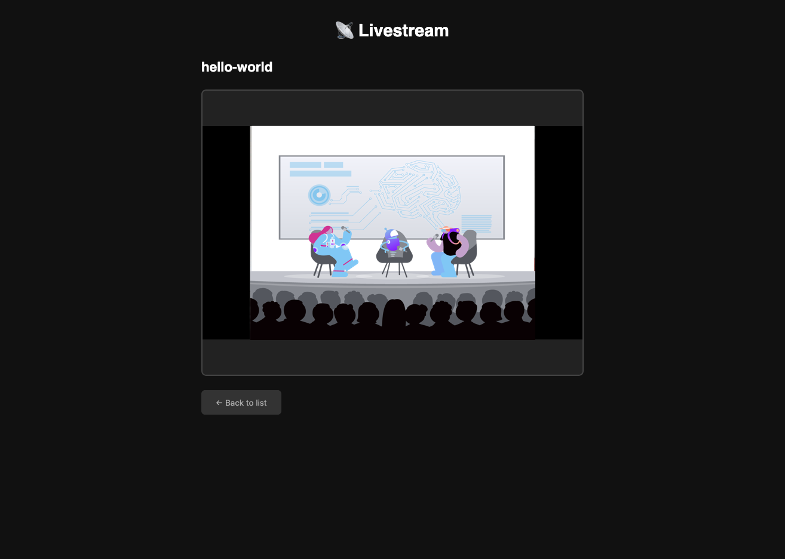

# Livestreaming with Python and Vonage Video

A minimal livestreaming web application that demonstrates how to embed live video broadcasting into your own application using Python, FastAPI, and the Vonage Video API.

## How It Works

* User navigates to the app and chooses to broadcast a livestream or view one
* Broadcaster grants camera and microphone permissions; a Vonage Video session is created with `ROUTED` media mode
* Backend generates a `MODERATOR` token to authenticate the broadcaster
* Broadcaster clicks **Go Live**, the backend calls `start_broadcast()`, and Vonage begins composing and outputting an HLS stream
* Frontend polls `/broadcast/status/{broadcast_id}` until the broadcast status updates to `ready`
* Once live, the HLS URL is served to viewers, who watch the stream embedded in the browser via `hls.js`
* Optionally, an RTMP output can be configured to simultaneously push the stream to YouTube or Twitch
* Broadcaster clicks **Stop**, backend calls `stop_broadcast()`, and the session ends

## Architecture

```text
Frontend (JavaScript + Vonage Video JS SDK)
  └─ Broadcaster UI: captures camera/mic via WebRTC, connects to Vonage session, publishes stream
  └─ Viewer UI: polls for HLS URL, plays stream via hls.js

Backend (Python + FastAPI + Vonage Python SDK)
  └─ Creates routed session and moderator token
  └─ Starts/stops broadcast via Vonage Video API
  └─ Polls and returns broadcast status and HLS URL

Vonage Cloud
  └─ Receives WebRTC stream from broadcaster
  └─ Composes stream via Vonage Media Router
  └─ Outputs HLS broadcast URL (and optionally RTMP)
  └─ CDN delivers HLS stream to unlimited viewers
```

The backend uses the Vonage Python SDK to control the full broadcast lifecycle. The JavaScript client SDK handles capturing media from the publisher's camera and mic via WebRTC. Session and broadcast details are stored in-memory for demonstration purposes. A production application should use a database.

## Project Structure

```text
.
├── server.py              # FastAPI app — routes, session, token, broadcast lifecycle
├── static/
│   ├── broadcaster.js     # Publisher UI — connects to session, starts/stops broadcast
│   └── viewer.js          # Viewer UI — polls for HLS URL, plays stream via hls.js
├── templates/
│   ├── index.html         # Landing page
│   ├── broadcaster.html   # Broadcaster view
│   └── viewer.html        # Viewer view
├── requirements.txt       # Python dependencies
├── .env.template          # Credential template
└── .gitignore
```

## Get This Code Running

### Prerequisites

* Python 3.10+
* A [Vonage API account](https://vonage.dev/4z9aQsn)
* [ngrok](https://vonage.dev/4d9waov) (optional — required for testing across devices)
* A [YouTube](https://support.google.com/youtube/answer/2907883?hl=en#) or [Twitch](https://help.twitch.tv/s/article/twitch-stream-key-faq?language=en_US) account (optional — required for RTMP streaming)

### 1. Clone the repo and set up your environment

Clone the repo, create and activate a virtual environment, and install dependencies:

```bash
git clone https://github.com/Vonage-Community/demo-livestream-python-video.git
cd demo-livestream-python-video
python -m venv .venv && source .venv/bin/activate  # Windows: .venv\Scripts\activate
pip install -r requirements.txt
```

Learn more about Python virtual environments in this [blog post](https://vonage.dev/42D6eeT).

### 2. Create a Vonage Video Application

1. Log in to the [Vonage Dashboard](https://vonage.dev/4AhETic)
2. Go to **Applications** and create a new application
3. Enable the **Video** capability
4. Click **Generate public and private key** -- once the file `private.key` is downloaded, move it to the project root directory
5. Keep this file secure and take care not to place it anywhere public

### 3. Configure your environment variables

Rename `.env.template` to `.env` and fill in your values:

```bash
cp .env.template .env
```

| Variable | Where to find it |
|----------|-----------------|
| `VONAGE_APPLICATION_ID` | Vonage Dashboard → Applications |
| `VONAGE_PRIVATE_KEY_PATH` | Path to `private.key` downloaded in Step 2 |

Learn more about storing and using environment variables here.

### 4. Start an ngrok tunnel (optional)

If you want to share your livestreaming application beyond your local server, use ngrok to create a tunnel on port `8000`:

```bash
ngrok http 8000
```

Copy the `https://` forwarding URL. To learn more about using ngrok with Vonage applications, read the [blog post on tunneling](https://developer.vonage.com/en/blog/local-development-nexmo-ngrok-tunnel-dr).

### 5. Run the server

```bash
fastapi dev app.py
```

## Try It Out!

Navigate to `http://127.0.0.1:8000/` (or your ngrok public URL). You will be presented with two options: **Broadcast a Livestream** or **View a Livestream**.



### Start a Livestream

1. Select **Broadcast a Livestream**
2. Grant permission to access your camera and microphone — a preview of your recording devices will appear
3. Name your broadcast and select **Go Live** to begin livestreaming
4. Check the console logs for polling updates — once the status changes to `ready`, your broadcast is live
5. Optionally, provide RTMP settings to simultaneously stream to YouTube or Twitch



### View a Livestream

1. In another browser tab (or on another device via your ngrok URL), navigate to the app
2. Select **View a Livestream** — you will see a list of active streams
3. Click on a stream to watch the broadcast

> Note: HLS has a 15–20 second initialization delay. The stream will not be available until the broadcast status updates to `ready`.

If you provided RTMP settings when starting your broadcast, navigate to that platform (YouTube Studio or your Twitch dashboard) to confirm the stream is live there as well.



## Troubleshooting

Because this project uses FastAPI, an interactive API explorer is available at:

```bash
http://127.0.0.1:8000/docs
```

The Swagger UI lists every route in the application along with expected request bodies and response schemas. Use it to call each endpoint directly from the browser to verify your credentials, inspect broadcast objects, and confirm session IDs are being returned before testing the frontend.

## Resources and References

* [Vonage Video API Overview](https://vonage.dev/4txlo1b): The starting point for the Video API — covers real-time video, screen sharing, broadcasting, recording, and live captions
* [Live Streaming Broadcasts Guide](https://vonage.dev/4yVXfTG): Full reference for starting, stopping, configuring layouts, and monitoring HLS and RTMP broadcasts
* [Vonage Video API Broadcast Overview](https://vonage.dev/4Agawb3): Compares live interactive video and live streaming broadcasts; covers HLS vs. RTMP vs. WebRTC and how each relates to the Vonage Media Router
* [Python Server SDK — Working with Broadcasts](https://vonage.dev/4zqdedZ): Full SDK reference with code samples for `start_broadcast`, `stop_broadcast`, and layout configuration
* [Build a Python Video Conferencing Web App With Flask and Vonage](https://vonage.dev/48yPEQg): Prerequisite tutorial covering Video API fundamentals — sessions, tokens, and WebRTC — with Python
* [Live Captions, Moderation, and Recording With Python and Vonage](https://vonage.dev/4aJBxcw): Companion post extending the Python Video API foundation with live captioning, moderation, and archiving
* [Connect Your Local Development Server Using an Ngrok Tunnel](https://vonage.dev/4d9waov): How to expose your local server to a public URL for testing and sharing